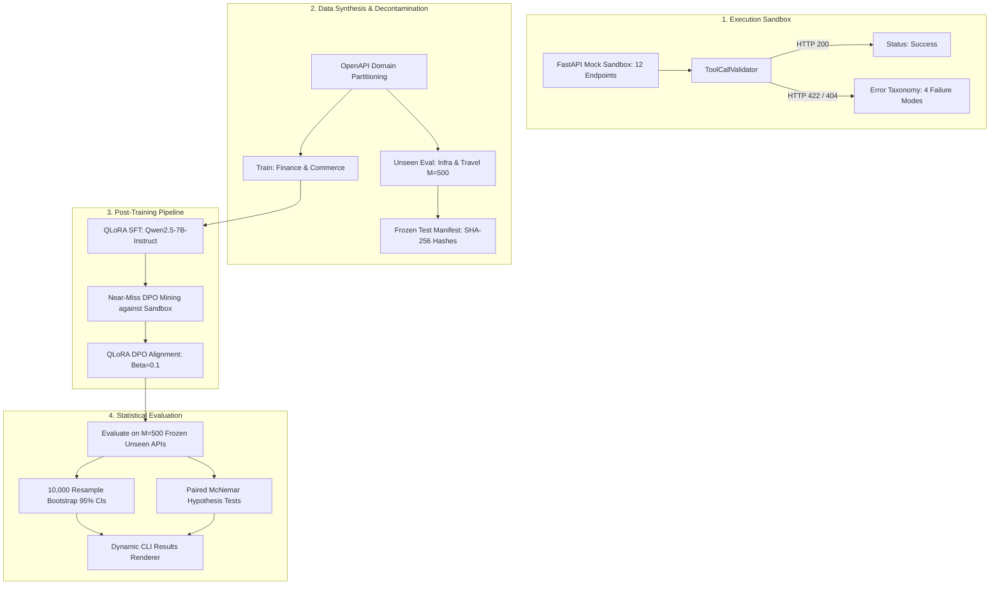

# VeriCall — Execution-Verified Post-Training for Tool Calling

[](https://github.com/bhuvneshsahu01/vericall/actions)
[](https://colab.research.google.com/github/bhuvneshsahu01/vericall/blob/main/VeriCall_Colab_Pro.ipynb)
[](https://www.python.org/downloads/)
[](https://opensource.org/licenses/MIT)

**VeriCall** is an execution-verified post-training framework that aligns Large Language Models (LLMs) to generate schema-compliant, executable tool calls. By coupling strict **Pydantic V2 runtime sandboxes** with **Direct Preference Optimization (DPO)**, VeriCall teaches models to reject hallucinated arguments, respect strict parameter types, and eliminate runtime API execution failures.

---

## 🌟 Key Architecture & Methodology

Traditional tool calling relies on uncalibrated prompting or constrained context-free grammars (CFGs). While CFGs enforce syntactic JSON validity, they cannot verify **semantic and type contracts** (e.g. required conditional parameters, valid regex patterns, cross-field dependencies, or domain-level enums). 

VeriCall bridges this gap using an **execution feedback loop**:



---

## 🔍 Structured Error Taxonomy

Every predicted tool call is categorized into one of five mutually exclusive states:

| Status Label | Description | Example Cause |
|:---|:---|:---|
| `success` | Function and arguments pass schema validation and execute with HTTP 200 in the sandbox. | Fully compliant call |
| `wrong_endpoint` | Function name not in registry or mismatches the ground-truth intent. | Hallucinated API name |
| `missing_arg` | Required parameter omitted from the arguments object. | Dropped mandatory ID |
| `hallucinated_arg` | Extra parameter not permitted by the strict schema (`extra="forbid"`). | Invented optional flag |
| `type_error` | Value violates datatype, regex constraint, range bounds, or enum values. | String passed for integer |

---

## 🚀 Quickstart

### 1. Installation

Clone the repository and install dependencies in Python 3.11+:

```bash
git clone https://github.com/bhuvneshsahu01/vericall.git
cd vericall
pip install -e .
```

### 2. Run Test Suite

Verify the 12 mock sandbox endpoints, validator taxonomy, and dataset decontamination:

```bash
pytest tests/ -v
```

### 3. Generate Data & Verify Test Manifest

Run the decontaminated data generation pipeline to freeze the $M=500$ held-out evaluation set:

```bash
python -m vericall.data.prep
```

This writes:
- `data/train_sft.jsonl`: 2,500 domain-partitioned training samples (`finance` and `commerce` domains).
- `data/eval_unseen_apis.jsonl`: Exactly $M=500$ held-out requests (`infra` and `travel` domains).
- `data/eval_bfcl_subset.jsonl`: 200 decontaminated BFCL evaluation samples.
- `data/test_manifest.json`: Cryptographic SHA-256 manifest of the evaluation sets.

### 4. Mine Execution-Verified DPO Pairs

Mine near-miss preference pairs validated against the FastAPI sandbox:

```bash
python -m vericall.data.mine_dpo
```

---

## ⚡ Google Colab AI Pro Training (L4 / A100 GPU)

The entire post-training and evaluation loop runs cleanly on Google Colab AI Pro:

[](https://colab.research.google.com/github/bhuvneshsahu01/vericall/blob/main/VeriCall_Colab_Pro.ipynb)

1. Launch **`VeriCall_Colab_Pro.ipynb`** in Google Colab with an L4 (24GB) or A100 (40GB) GPU runtime.
2. Run all cells:
   - Sets up fast 4-bit Unsloth patching for `unsloth/Qwen2.5-7B-Instruct`.
   - Runs baseline evaluation on $M=500$ unseen requests.
   - Executes QLoRA SFT ($r=16, \alpha=32$).
   - Mines near-miss preference pairs against the sandbox.
   - Runs QLoRA DPO alignment ($eta=0.1$).
   - Computes 10,000-resample bootstrap 95% confidence intervals and paired McNemar tests.
   - Exports `results/eval_summary.json` and LoRA adapters.

---

## 📊 Reproducible Evaluation & Results Renderer

In accordance with strict open-source integrity, **no benchmark numbers are hardcoded into this repository**. All metrics must be computed from actual model generations:

```bash
python scripts/render_results.py
```

The script parses `results/eval_summary.json` and renders:
1. Complete Markdown benchmark comparison table with 95% bootstrap confidence intervals.
2. Formatted LaTeX bullet snippet ready for CV inclusion.
3. Breakdown of error reductions across each failure mode.

---

## 📁 Repository Structure

```
vericall/
├── data/                         # Pre-training frozen evaluation and training datasets
│   ├── eval_unseen_apis.jsonl    # M=500 held-out evaluation requests
│   ├── eval_bfcl_subset.jsonl    # 200 decontaminated BFCL evaluation samples
│   ├── train_sft.jsonl           # 2,500 training samples
│   ├── train_dpo.jsonl           # Mined DPO preference pairs
│   └── test_manifest.json        # Pre-training SHA-256 test set hashes
├── vericall/
│   ├── sandbox/                  # Execution-verified mock API sandbox
│   │   ├── app.py                # 12 FastAPI endpoints
│   │   ├── models.py             # Strict Pydantic V2 models (extra="forbid")
│   │   └── validator.py          # 5-status ToolCallValidator
│   ├── data/                     # Generation and mining pipelines
│   │   ├── prep.py               # Dataset generation and decontamination
│   │   └── mine_dpo.py           # Near-miss DPO pair miner
│   ├── train/                    # Post-training modules
│   │   ├── train_sft.py          # QLoRA SFT via Unsloth/TRL
│   │   └── train_dpo.py          # QLoRA DPO via TRL
│   └── eval/                     # Evaluation harness
│       ├── evaluate.py           # Multi-model evaluation loop
│       └── stats.py              # Bootstrap CIs & paired McNemar tests
├── notebooks/
│   └── Colab_Pro_Run_All.ipynb   # Standalone 10-stage training notebook
├── scripts/
│   └── render_results.py         # Dynamic CLI results renderer
├── tests/                        # 100% passing Pytest test suite
│   ├── test_sandbox.py           # Endpoints and validator tests
│   ├── test_data_prep.py         # Decontamination and M=500 tests
│   ├── test_stats.py             # Statistical test verification
│   └── test_dpo_miner.py         # DPO preference integrity tests
├── pyproject.toml                # Project metadata and dependencies
├── Makefile                      # One-command workflows
└── README.md
```

---

## 📄 Citation & License

MIT License. Developed by [Bhuvnesh Sahu](https://github.com/bhuvneshsahu01).
